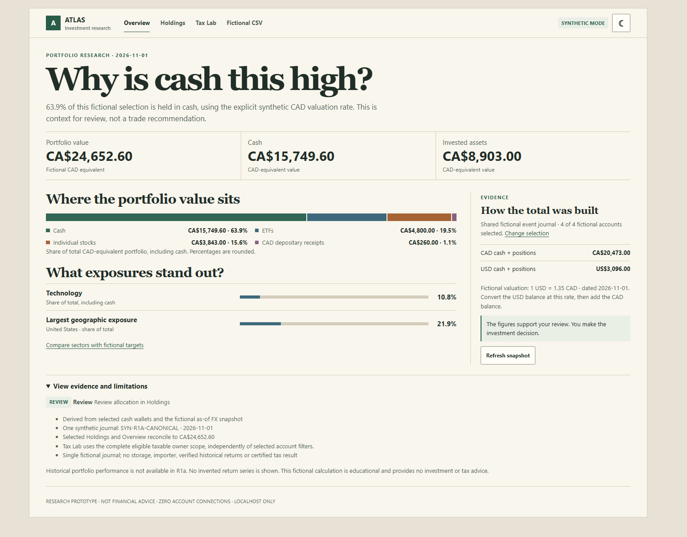
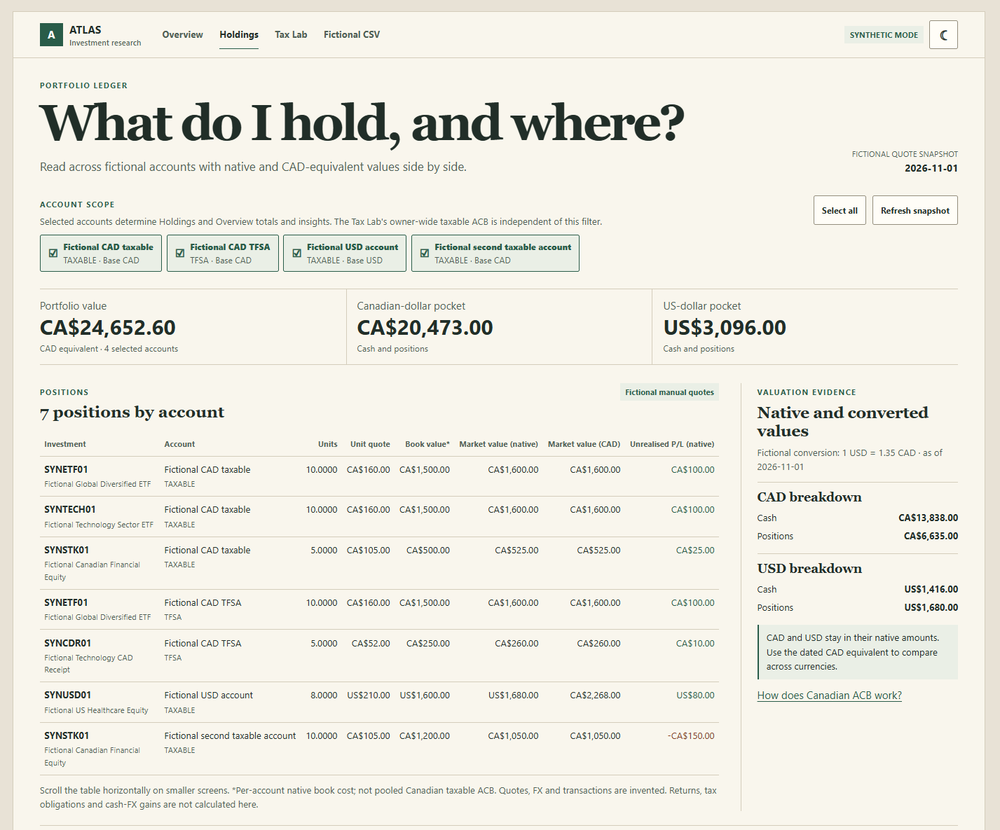
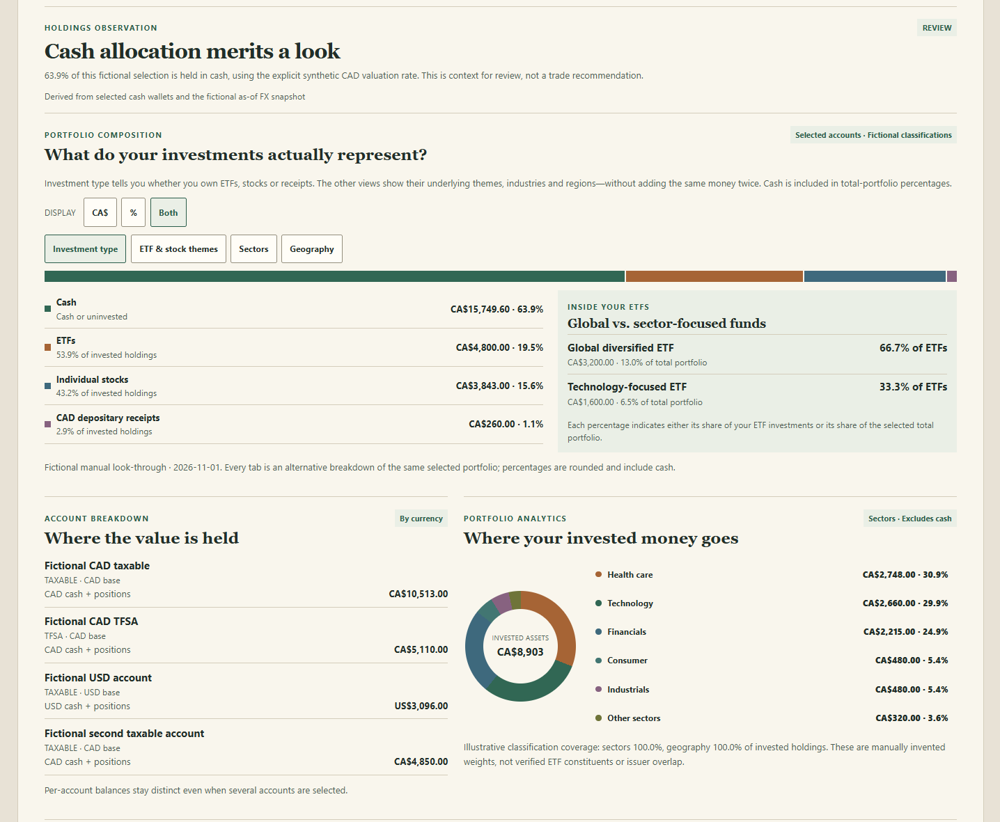
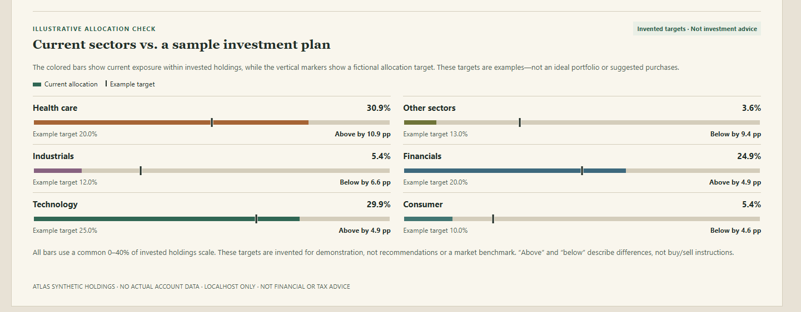
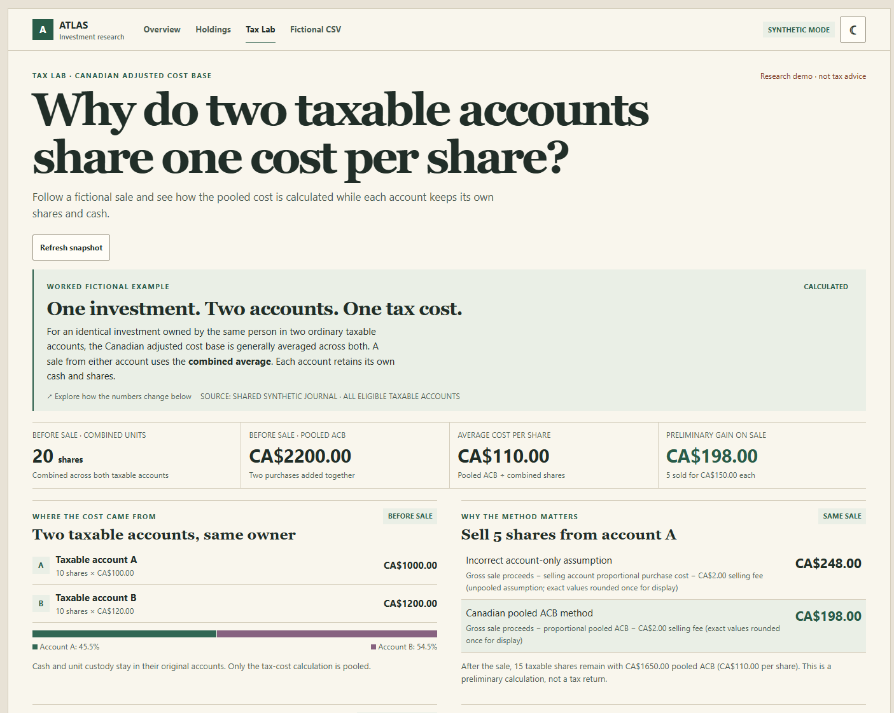
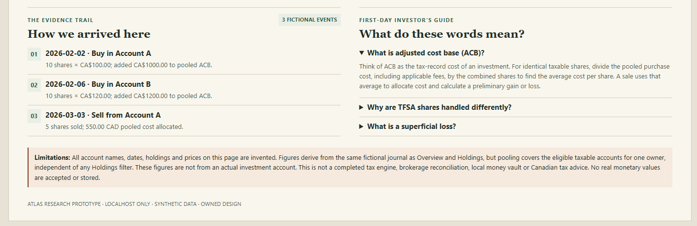
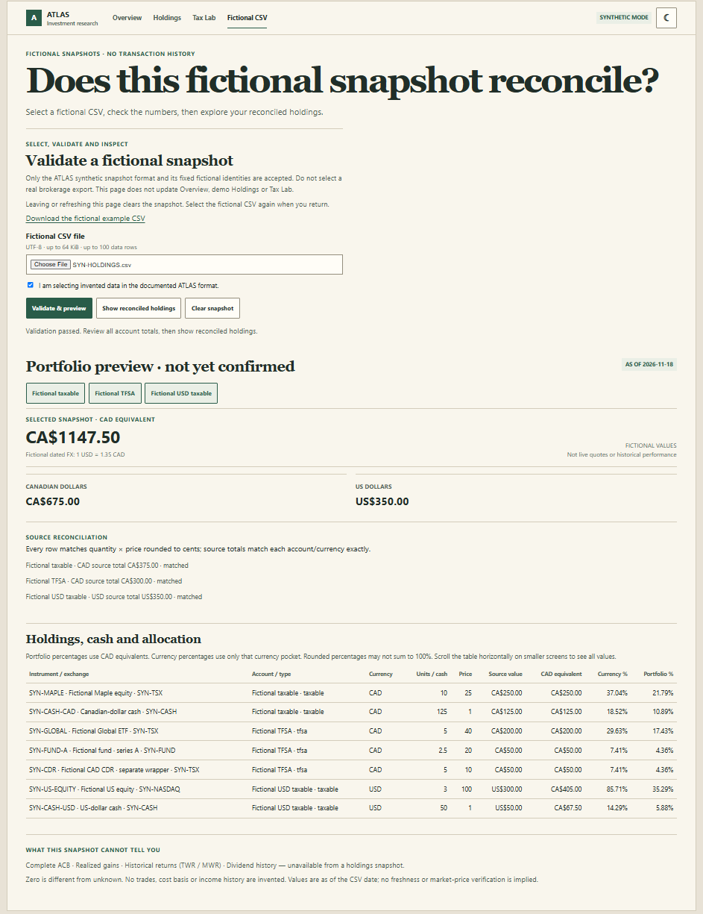

# ATLAS — Personal Investment Intelligence

**Why I started ATLAS.** I am not a professional investor, nor am I trying to become a full-time financial analyst. I started **ATLAS** because I wanted to better understand my own investments, learn how financial markets and investment strategies work, and make more informed decisions using objective evidence rather than intuition alone.

Like many self-directed investors, I have investments spread across different accounts, currencies, and asset classes. Understanding what I actually own, how my investments are distributed, and whether my decisions make sense is not always straightforward. Financial terminology can be complicated, information is scattered across different sources, and it can be difficult to distinguish meaningful evidence from speculation or market noise.

**The idea.** My idea was to build a personal tool that could bring these pieces together. I wanted something that would help me visualise and analyse my portfolio, explain unfamiliar financial concepts in accessible language, and eventually use AI to research investment questions and evaluate potential decisions against transparent, data-driven criteria. Rather than simply telling me what to buy or sell, the goal is to help me understand **why a particular decision might or might not be justified**, while keeping the final decision entirely in my hands.

ATLAS is also an opportunity to explore how software engineering, mathematical modelling, data analysis, and AI can be combined to solve a practical problem outside my usual aerospace engineering work. I am building it primarily for my own learning and use, with an emphasis on transparency, reproducibility, privacy, and avoiding unnecessary complexity.

**Portfolio scope.** This is a focused, independently implemented demonstration of selected ideas from a larger private product. It shows traceable portfolio calculations and a bounded adjusted cost base example using fictional accounts, positions, prices, weights, exchange rates and transactions. AI-assisted interpretation and decision thresholds are part of the broader vision. Trade execution is outside the demo’s scope.

## Explore the demo

### Research Overview

Start with the key takeaway and follow it back to the figures behind it. The overview shows CAD and USD balances alongside the combined CAD-equivalent value and allocation, using a dated fictional exchange rate.



### Holdings and Ledger

Change the fictional account selection to see how Holdings and Overview totals respond. The ledger shows native and CAD-equivalent position values side by side, with the dated fictional exchange rate in the valuation panel.



### Portfolio Composition

Compare investment types and the split between global and sector-focused ETFs, then use the Holdings tabs to explore sectors and regions. The composition bar uses the total portfolio, including cash. The sector chart uses invested assets only and relies on illustrative classifications.



### Allocation Comparison

Compare current sector weights with a sample plan on a common scale. Bars show invested exposure, markers show invented targets, and labels report the gaps in percentage points. The example provides context for review and carries no trade recommendation.



### Canadian Tax Lab

Follow a five-share sale from one of two fictional taxable accounts held by the same owner. The example explains how pooling the adjusted cost base (ACB) of identical property changes the preliminary gain from CA$248 under an incorrect account-only assumption to CA$198 using pooled ACB. The example is educational and does not provide tax advice.



Follow the three fictional transactions and open the plain-language explanations for ACB, TFSAs and superficial losses.



### Fictional CSV preview

Enable CSV Preview, select the supplied fictional example locally, acknowledge the fictional-input prompt and validate it. The preview shows matched source totals by account and currency before confirmation. This separate browser-memory snapshot is cleared on refresh or navigation.



## Run locally

Use Node.js 24 and a modern browser. The app uses Node's standard library and local web assets.

```sh
node prototypes/owned/backend/server.mjs --synthetic-csv
```

Open `http://127.0.0.1:4711`. Omit `--synthetic-csv` to run the three core views. Use the supplied [fictional example](prototypes/owned/fixtures/SYN-HOLDINGS.csv.txt) for the optional preview.

## Engineering and methods

- [Fictional journal and valuations](prototypes/owned/backend/r1a-journal.mjs) supply the shared inputs for [deterministic projections](prototypes/owned/backend/r1a-unified.mjs). [Exposure calculations](prototypes/owned/backend/exposure.mjs) distinguish invested-weight and total-portfolio denominators.
- [Exact rational arithmetic](prototypes/owned/accounting/rational.mjs) keeps fractions exact through calculation. [The ACB engine](prototypes/owned/accounting/r0f-taxable-acb.mjs) covers a bounded buy-and-sell example and states its exclusions alongside the code.
- [The CSV validator](prototypes/owned/web/synthetic-csv.mjs) accepts a bounded fictional format with fixed synthetic identities. [The browser preview](prototypes/owned/web/import.js) reconciles the selected rows in memory. The [local server](prototypes/owned/backend/server.mjs) serves an explicit set of routes.

## Verification

```sh
node --test prototypes/owned/accounting/*.test.mjs prototypes/owned/tests/*.test.mjs
```

Coverage includes [accounting invariants](prototypes/owned/accounting/r0f.test.mjs), [cross-view reconciliation](prototypes/owned/tests/r1a-unified.test.mjs), [theme defaults and preference persistence](prototypes/owned/tests/r0g-ui.test.mjs), and [the fictional CSV boundary](prototypes/owned/tests/r1bc2b-csv.test.mjs). The owner ran the full suite in Windows PowerShell after the notebook redesign and theme test correction. All 586 tests passed. The owner also captured and approved the light-theme screenshots above.

## Scope and privacy

Use the packaged fictional data only. The demo runs on loopback and the optional CSV is parsed in browser memory. Live quotes, brokerage connections, trade execution, AI investment signals, retained portfolios and production encryption are outside this demo's scope. Tax Lab is an educational calculation with a bounded scenario. Tax filing, superficial-loss determination and other cases listed in the engine are outside its coverage.
